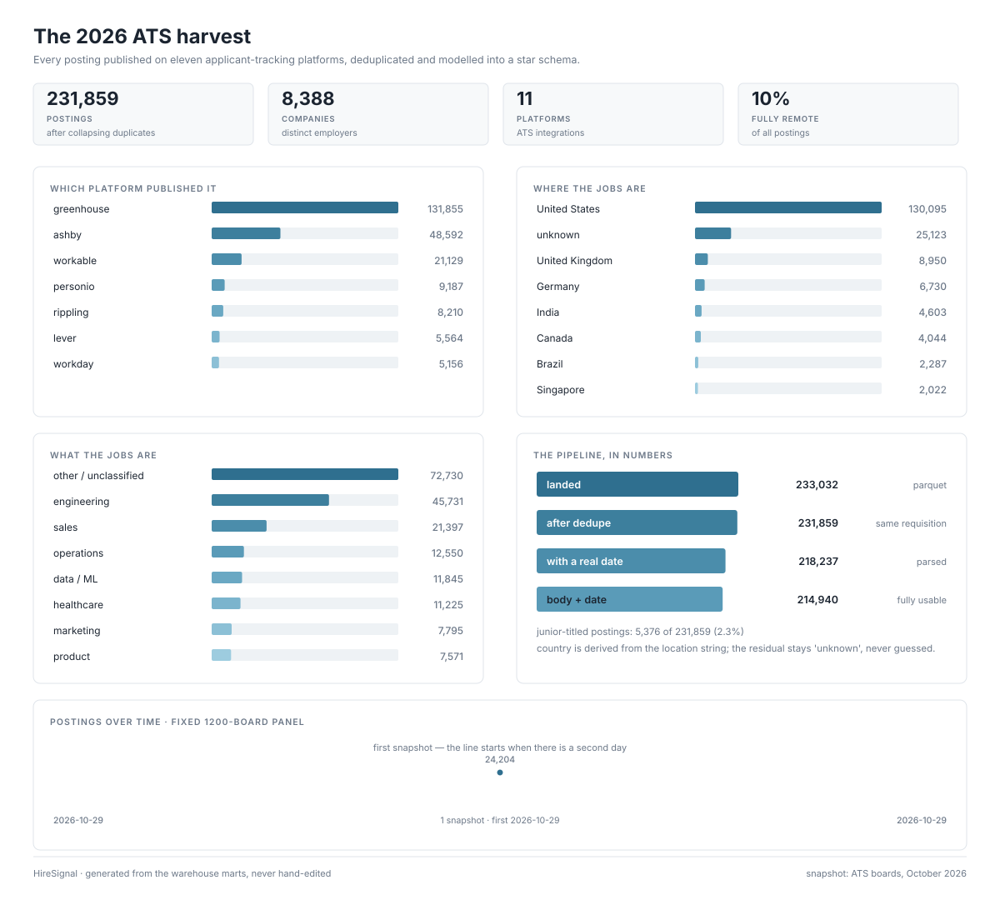

# HireSignal — a job-market warehouse

**231,859 postings from eleven applicant-tracking systems, modelled into a star schema in SQL, with a dashboard that renders from the data.**


[**Live dashboard →**](https://garasnote.github.io/hiresignal/) · updated daily at 07:30, one page per day



Two pipelines live in this repo. The **ATS harvest** is the volume piece: every posting published on Greenhouse, Ashby, Workable, Personio, Rippling, Lever, Workday, Recruitee, iCIMS, Oracle Cloud and Paylocity, landed as Parquet, conformed and deduplicated in SQL, then modelled into dimensions and a fact table. The **Spanish boards** pipeline is the craft piece: scrapers for elempleo and computrabajo with an idempotent SQLite load, star schema and CSV exports for Power BI.

## What the data says

- **Six platforms are the market.** Greenhouse (56.9%), Ashby (21.0%), Workable (9.1%), Personio (4.0%), Rippling (3.5%) and Lever (2.4%) publish 96.9% of everything. Workday, iCIMS and Oracle Cloud carry the rest, and they are the hardest to scrape — which is why the long tail is under-represented in most job-market datasets.
- **It is an American market.** 56.1% of postings are in the United States against 3.9% United Kingdom and 2.9% Germany. Only 10.4% are fully remote.
- **It is a senior market.** 5,376 postings (2.3%) carry a junior, graduate, intern or trainee title.
- **Titles are a long tail.** 31.4% fall outside fifteen role families — from *Auxiliaire de vie* to *Solutions Architect* to *Line Cook*. Any "role family" column is a lossy convenience, and this warehouse says so instead of hiding it.

## How it is built

| stage | object | what happens |
|---|---|---|
| land | `stg_postings` | Parquet read as-is, one row per posting |
| conform | `stg_conformed` | title/company/location normalised, role family and country derived |
| collapse | `stg_dedup` | same requisition + same place keeps the longest body |
| model | `dim_company`, `dim_ats`, `dim_location`, `dim_role`, `dim_date`, `fact_posting` | surrogate-key star schema |
| publish | `mart_*` | one mart per question, in `sql/marts_ats.sql` |
| render | `docs/dashboard.svg` | generated by `dashboard/build_svg.py`, never hand-edited |

Deduplication is part of the model, not an afterthought: the same requisition is routinely listed once per city, and one board carried 317 copies of a single vacancy. Identity is company + title with the requisition number stripped + normalised location; the copy with the longest body survives, and `mart_quality` reports how many were collapsed.

## Run it

```bash
pip install -e ".[ats]"

# the committed 5,588-row sample (this is what CI runs)
python3 pipeline/ats.py
python3 dashboard/build_svg.py

# the full snapshot, if you have it
python3 pipeline/ats.py --parquet /path/to/postings_all.parquet
python3 dashboard/build_svg.py --db warehouse_ats.duckdb

python3 -m unittest discover -s tests -v
```

## Data quality, stated

| stage | rows | note |
|---|---|---|
| landed | 233,032 | Parquet snapshot, October 2026 |
| after dedupe | 231,859 | same requisition, same place |
| with a parsed date | 218,237 | `posted_at` is free text |
| with body text | 214,942 | retrievable, not title-only |
| body **and** date | 214,940 | fully usable |

Country is derived from the location string and **10.8% stays `unknown`** rather than being guessed. `posted_at` arrives as prose on some boards ("Posted Yesterday"), so 5.8% has no date and joins the unknown member of `dim_date`. The committed sample is 5,588 rows so the repo stays cloneable; the full 111 MB snapshot is not in git.

## The Spanish boards pipeline

The original pipeline, kept because it exercises a different skill: scraping paginated HTML, parsing messy salary strings (`$4,5 - 5,5 M`), and loading idempotently into SQLite.

```bash
python3 pipeline/run.py --offline   # fixture, no network — used by CI
python3 pipeline/run.py --live      # scrapes ~8 pages, takes ~1 min
```

Outputs land in `warehouse.db` and `exports/*.csv` (star schema for Power BI). Metabase can sit on top: `cd bi && docker compose up -d` brings it up on port 3033; add `warehouse.db` as a SQLite database and build the three questions listed in `bi/`.

## What I'd say in an interview

- The grain of every fact table is one posting; dimensions carry surrogate keys, so the model stays a star.
- Ingestion is idempotent on both pipelines: re-running never duplicates rows, and re-building the warehouse is a single command.
- Experience and seniority are parsed from the posting text, not the title, because titles lie — a "junior" ad in this dataset asked for five years.
- Deduplication is a modelled step with a metric (`mart_quality`), not a cleanup script someone runs by hand.
- The dashboard is generated from the marts by code, so the picture cannot drift from the data.
- The site is real HTML, not an SVG image: every figure selects, copies and reads aloud, and each
  daily snapshot has its own URL (`/2026-10-29/`) so history is browsable without JavaScript.
- Visual language: [`DESIGN.md`](DESIGN.md), copied from the Sentry entry in the
  [getdesign.md](https://getdesign.md/) catalogue (violet-midnight canvas, lime accent, Rubik).

## Repo map

```
pipeline/ats.py        Parquet -> DuckDB star schema -> marts
pipeline/run.py        Spanish boards -> SQLite star schema -> CSV exports
sql/ats_schema.sql     conform, dedupe, dimensions, fact
sql/marts_ats.sql      one mart per question
dashboard/build_svg.py renders docs/dashboard.svg (the README image)
dashboard/build_site.py one HTML page per snapshot + the full-harvest page
dashboard/render_html.py semantic HTML, CSS bars, no JS
DESIGN.md              design tokens the site is built from (Sentry)
data/sample/           5,588-row Parquet sample used by tests and CI
tests/                 17 tests: pipeline invariants + dashboard renders
```

## Status

- [x] ATS harvest: 233,032 postings, 11 platforms, dedupe in SQL
- [x] DuckDB star schema + seven marts
- [x] generated dashboard: one HTML page per day, browsable history, no JS
- [x] daily 1,200-board panel snapshot (systemd timer, 07:30)
- [x] scrapers (elempleo, computrabajo), idempotent SQLite load
- [x] CSV export for Power BI
- [x] offline fixture + CI
- [ ] daily refresh of the *full* harvest (the panel refreshes daily; the 233k build is manual)

## License

WTFPL — do what you want.
